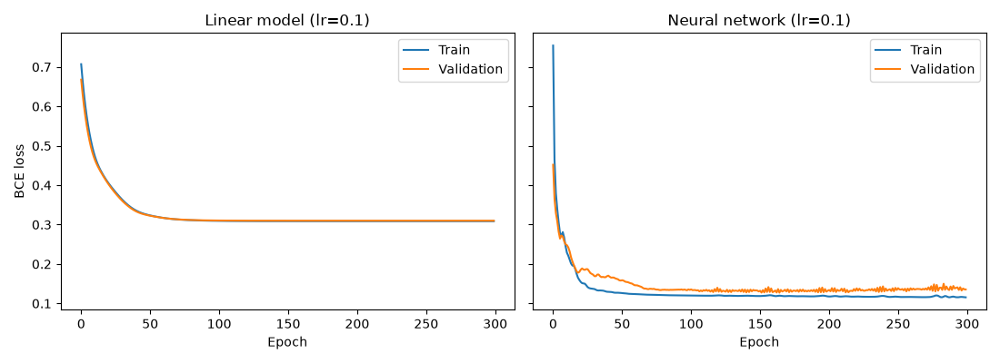
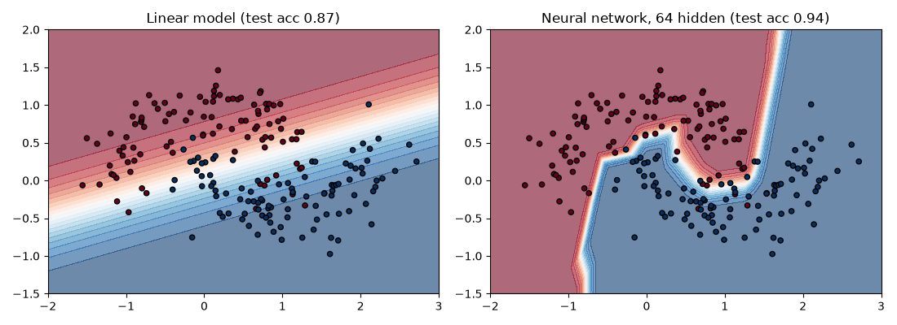

# Assignment 2: Neural Network Comparison

## Task
Compare a linear model with a neural network on a two-class dataset that is not linearly separable, and study the effect of hidden-layer size and learning rate.

## Setup
- Data: two moons (`make_moons`), 1000 samples, noise 0.25
- Split: 600 train, 200 validation, 200 test (stratified)
- Linear model: logistic regression (one `Linear(2, 1)` layer)
- Neural network: `Linear(2, h)`, ReLU, `Linear(h, 1)`, with h in {2, 4, 16, 64}
- Loss: binary cross-entropy, optimizer: Adam, 300 epochs
- Learning rates tried: 0.001, 0.01, 0.1
- The best model of each type was chosen by validation accuracy, then evaluated once on the test set.

## Comparison table
| Model | Hidden size | Learning rate | Train acc | Val acc | Test acc |
|-------|-------------|---------------|-----------|---------|----------|
| Linear | 0 | 0.001 | 0.5883 | 0.615 | 0.59 |
| Linear | 0 | 0.01 | 0.8133 | 0.81 | 0.82 |
| Linear | 0 | 0.1 | 0.8617 | 0.845 | 0.87 |
| Neural net | 2 | 0.001 | 0.755 | 0.78 | 0.76 |
| Neural net | 2 | 0.01 | 0.8617 | 0.845 | 0.87 |
| Neural net | 2 | 0.1 | 0.8617 | 0.845 | 0.87 |
| Neural net | 4 | 0.001 | 0.81 | 0.75 | 0.765 |
| Neural net | 4 | 0.01 | 0.8717 | 0.855 | 0.89 |
| Neural net | 4 | 0.1 | 0.875 | 0.88 | 0.87 |
| Neural net | 16 | 0.001 | 0.8383 | 0.83 | 0.845 |
| Neural net | 16 | 0.01 | 0.9417 | 0.94 | 0.96 |
| Neural net | 16 | 0.1 | 0.9433 | 0.955 | 0.945 |
| Neural net | 64 | 0.001 | 0.885 | 0.875 | 0.885 |
| Neural net | 64 | 0.01 | 0.9367 | 0.945 | 0.95 |
| Neural net | 64 | 0.1 | 0.9467 | 0.96 | 0.945 |

## Best models
| Model | Hidden size | Learning rate | Val acc | Test acc | Test precision | Test recall |
|-------|-------------|---------------|---------|----------|----------------|-------------|
| Linear | 0 | 0.1 | 0.845 | 0.870 | 0.870 | 0.870 |
| Neural network | 64 | 0.1 | 0.960 | 0.945 | 0.959 | 0.930 |

## Graphs

## Which model performed best and why
The neural network with 64 hidden units and a learning rate of 0.1 performed best, with 94.5% test accuracy against 87.0% for the best linear model. The two moons are curved and interlocked, so no straight line can separate them. The linear model can only draw a straight decision boundary, so it underfits: it misclassifies points on the curved parts of both moons. The hidden ReLU layer adds nonlinearity, so the network can bend its decision boundary around the curves, as the decision boundary graph shows.

Hidden-layer size mattered. With 4 hidden units the network reached only about 87 to 89% test accuracy, close to the linear model, because it had too little capacity to follow both curves. With 16 hidden units accuracy rose to about 94.5 to 96%, and 64 units gave about the same, so beyond 16 units the extra size added little.

The learning rate mattered too. With only 300 epochs, lr = 0.001 was too slow (84.5 to 88.5% test accuracy for the 16 and 64 unit networks), while 0.01 and 0.1 both reached the 94.5 to 96% range. lr = 0.1 gave the highest validation accuracy, so it was selected.

One setting (16 hidden units, lr = 0.01) scored 96% on the test set, slightly above the selected model. The best model was still chosen on validation accuracy, not test accuracy, because choosing by test results would make the final test score optimistic. The test set has only 200 samples, so differences of one or two points between settings are within noise. The 7.5-point gap between the linear model and the neural network is large enough to be reliable. The training and validation accuracy of the best network stay close together, so there is no strong sign of overfitting.