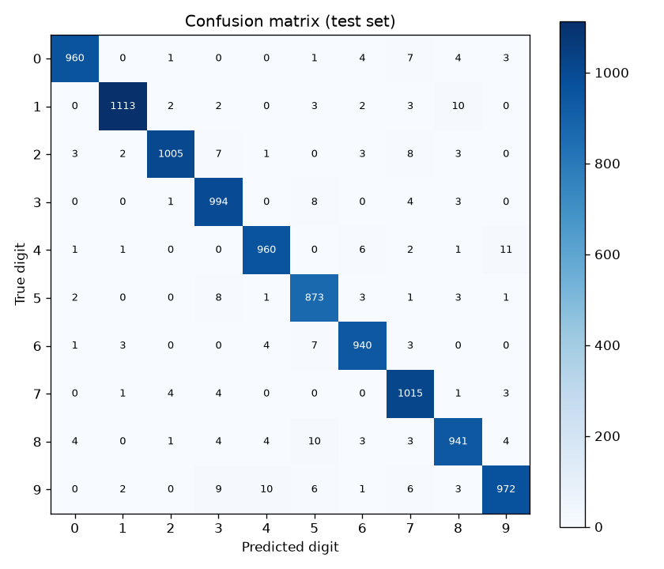
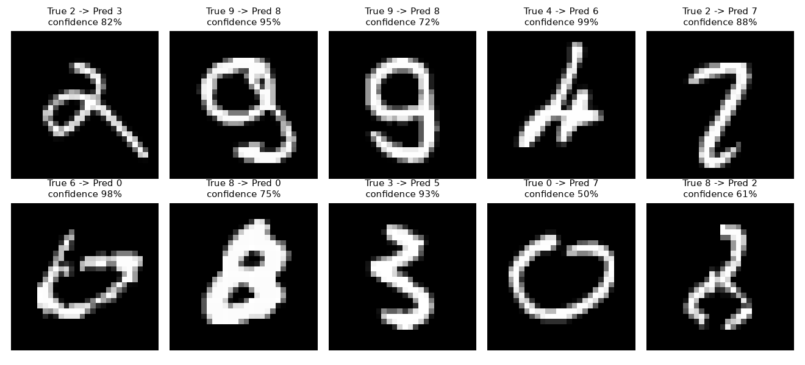

# Mini Project 2: Handwritten Digit Classifier

A fully connected neural network trained on MNIST to recognise the digits 0-9.

## Setup
- Data: MNIST, 50,000 train / 10,000 validation / 10,000 test
- Model: 784 -> 256 -> 128 -> 10, ReLU, dropout 0.2
- Loss: cross-entropy, optimizer: Adam (lr 0.001), 10 epochs, batch size 64

## Sample digits

)

## Results
- Final validation accuracy: 97.50%
- Test accuracy: 97.73% (227 wrong predictions out of 10,000)
- Lowest recall: digit 9 (0.963), digit 8 (0.966), digit 2 (0.974)
- Lowest precision: digit 5 (0.961), digit 7 (0.965), digit 3 (0.967)

## Confusion matrix

## Incorrect predictions

Most common mistakes:
- true 4 predicted as 9: 11 times
- true 9 predicted as 4: 10 times
- true 8 predicted as 5: 10 times
- true 1 predicted as 8: 10 times
- true 9 predicted as 3: 9 times

## Error analysis
Most errors happen between digits that share strokes. The biggest pair is 4 and 9 (21 mistakes in both directions), where a closed or open top decides the class. Digit 9 has the lowest recall, because it is confused with both 4 and 3. Digit 8 is often read as 5, and some thin or slanted 1s are read as 8. Many wrong images are badly written and hard to read even for a person.

Training loss kept falling (0.3561 to 0.0399), but validation loss stopped improving after epoch 5 (0.0787 to 0.0861). This is the start of overfitting, so the model memorises the training set a little instead of learning more.

Possible reasons: similar shapes, messy handwriting, and a fully connected network that treats every pixel separately, so it is sensitive to shifts and slants.

How to improve: use a convolutional neural network, add data augmentation (small shifts and rotations), and use early stopping at about epoch 5 or 6.
