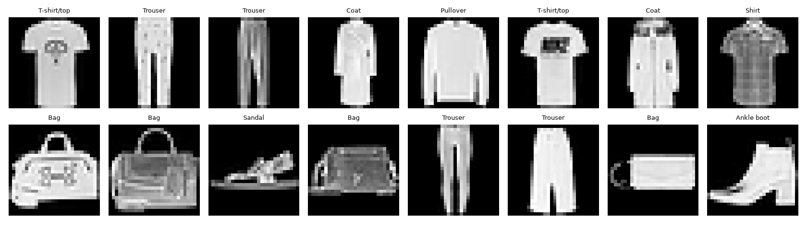
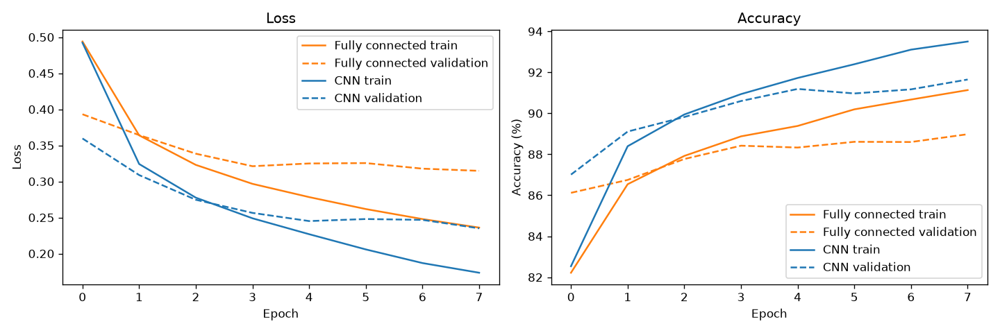
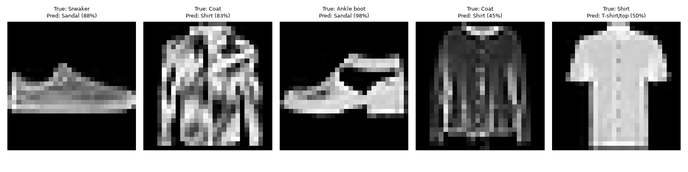

# Assignment 3: Build and Evaluate a CNN

Code: [assignment3.py](assignment3.py) (cells marked with `# %%`)

## Setup
- Data: Fashion-MNIST, 50,000 train / 10,000 validation / 10,000 test, normalised with mean 0.2860 and std 0.3530
- Fully connected baseline: 784 -> 128 -> 64 -> 10
- Small CNN: two convolution blocks (16 and 32 filters, 3x3, padding 1, ReLU, 2x2 max pooling), then 64 -> 10
- Adam, learning rate 0.001, batch size 64, 8 epochs

## Sample images

## Training and validation curves

## Comparison
| Model | Parameters | Val acc | Test acc | Train time (s) |
|---|---|---|---|---|
| Fully connected | 109,386 | 88.98% | 88.18% | 133 |
| Small CNN | 105,866 | 91.65% | 91.35% | 234 |

## Five misclassified examples
The CNN made 865 mistakes on 10,000 test images.

1. **Sneaker predicted as Sandal (Sandal 88.4%, Bag 8.7%).** Both are low footwear. At 28x28 pixels, a sneaker with a light or perforated design can look like the open straps of a sandal. The model was confident, and Sneaker got under 3%.
2. **Coat predicted as Shirt (Shirt 83.3%, Coat 16.4%).** Coats and shirts are both long-sleeved garments with a front opening, and the small details that separate them (thickness, collar) are lost at this size. The true class was the model's second choice.
3. **Ankle boot predicted as Sandal (Sandal 98.2%, Bag 1.6%).** This is a confident mistake, and Ankle boot was not even in the top two. The item probably has a low cut or an open shape that resembles a sandal, so the model was fooled by its outline. It could also be an unusual or ambiguous example.
4. **Coat predicted as Shirt (Shirt 45.3%, Pullover 34.8%).** Here the model was unsure and spread its probability over three similar upper-body garments. Coat, Shirt and Pullover share the same outline, so only fine details separate them.
5. **Shirt predicted as T-shirt/top (T-shirt/top 49.7%, Shirt 49.5%).** This is nearly a coin flip, with a 0.2-point difference. A shirt and a T-shirt differ mainly in collar, buttons and sleeve length, which are hard to see in a 28x28 image. A tiny change in the picture could flip the answer.

**Pattern:** most mistakes are between look-alike classes, such as Shirt, T-shirt, Pullover and Coat, or Sneaker, Sandal and Ankle boot. Some are confident errors, and others are near ties.

## Conclusion
The CNN performed better, with 91.35% test accuracy against 88.18% for the fully connected baseline, a gain of 3.17 points while using slightly fewer parameters (105,866 vs 109,386). A fully connected network treats every pixel independently, so it ignores that nearby pixels form shapes. A CNN slides the same small filters across the whole image, so it detects edges and shapes wherever they appear, and it reuses those weights, which keeps the parameter count low. The cost is training time (234 s vs 133 s). Both models overfit a little, since training accuracy ended about 2 points above validation accuracy. The test set was used only once, at the end.