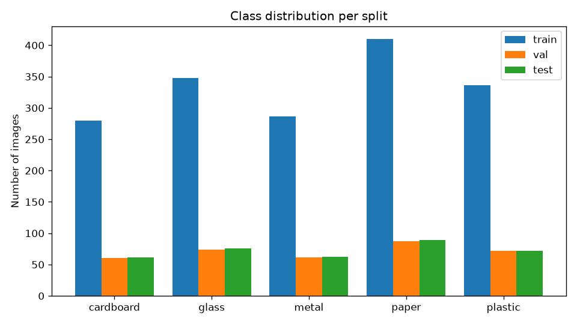
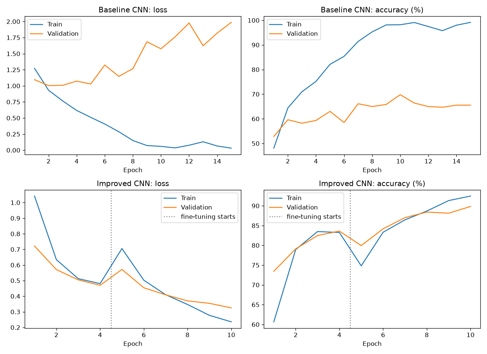
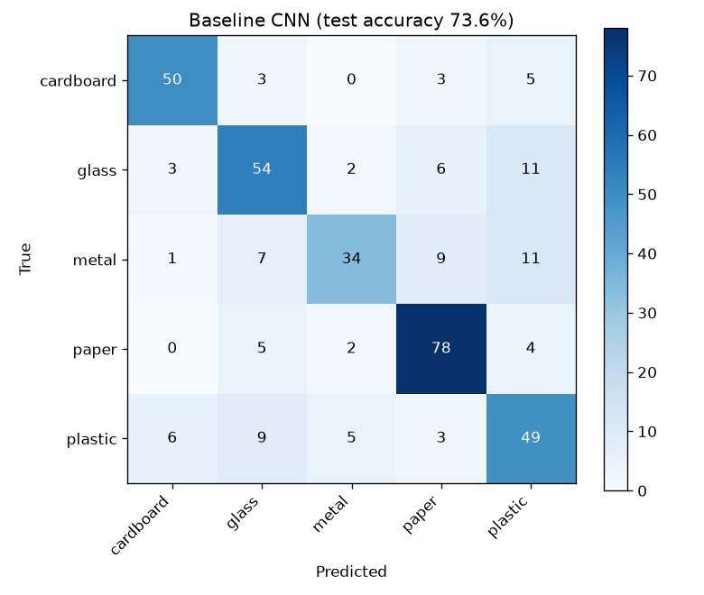

# Assignment 4: Final Model Evaluation

Project: Waste Image Classification System (Major Project, Week 4). The code, models and the Gradio app are in
[Major-Project/waste_classifier](../Major-Project/waste_classifier/).

## 1. Dataset source, class distribution and split sizes

**Source:** the Kaggle "Garbage Classification" dataset, a TrashNet-style collection of photos of single waste items
(Thung and Yang, Stanford). Check the licence on the Kaggle page; the images are not stored in this repository.
I used 5 of its 6 categories: cardboard, glass, metal, paper, plastic. The sixth category ("trash") has far fewer images and is a
catch-all, so it was left out.

| Class | Raw images | After duplicate removal | Train | Val | Test |
|---|---|---|---|---|---|
| cardboard | 403 | 401 | 280 | 60 | 61 |
| glass | 501 | 498 | 348 | 74 | 76 |
| metal | 410 | 409 | 286 | 61 | 62 |
| paper | 594 | 586 | 410 | 87 | 89 |
| plastic | 482 | 480 | 336 | 72 | 72 |
| **Total** | **2390** | **2374** | **1660** | **354** | **360** |

- **Class balance:** the largest class (paper, 586 images) is 1.5 times the size of the smallest (cardboard, 401 images).
- **Duplicates:** 0 exact duplicates and 6 near-duplicates (same picture resized or re-saved, at most 10 of 256 hash bits different) were removed, and 10 pictures that appeared under two different labels were dropped. 0 unreadable files were skipped.
- **Split:** each class was split 70% train, 15% validation and 15% test with a fixed random seed. After copying, every file was hashed again and **0 identical images appear in more than one split**, so duplicates cannot leak from training into testing.
- **Known weakness:** photos of the same object taken from different angles may still land in different splits, which can make the test score slightly optimistic.

## 2. Model configurations and results

| Configuration | Description | Parameters | Training time | Best epoch | Validation acc | Test acc |
|---|---|---|---|---|---|---|
| Baseline CNN | 3 conv blocks trained from scratch, no augmentation | 1,662,373 | 5.9 min | 10 | 69.8% | 73.6% |
| Improved CNN | MobileNetV2 pretrained + fine-tuning + augmentation + dropout | 2,230,277 | 6.9 min | 10 | 89.8% | 92.8% |

The improved CNN scored 92.8% on the test set against 73.6% for the baseline, which is 19.2 percentage points higher. The test set has only 360 images, so an accuracy of 92.8% has a 95% margin of about plus or minus 2.7 points, and differences of a point or two between models are within noise.

## 3. Training curves and overfitting

- At the last epoch the baseline CNN reached 99.2% training accuracy and 65.5% validation accuracy (difference +33.6 points). This large gap suggests the model is memorising the training images (overfitting).
- At the last epoch the improved CNN reached 92.5% training accuracy and 89.8% validation accuracy (difference +2.6 points). The gap is small, so there is little sign of overfitting.

## 4. Per-class results (improved CNN)

| Class | Precision | Recall | F1 | Test images |
|---|---|---|---|---|
| cardboard | 95.2% | 96.7% | 95.9% | 61 |
| glass | 91.7% | 86.8% | 89.2% | 76 |
| metal | 90.6% | 93.5% | 92.1% | 62 |
| paper | 95.5% | 95.5% | 95.5% | 89 |
| plastic | 90.4% | 91.7% | 91.0% | 72 |

The easiest class was **cardboard** (recall 96.7%) and the hardest was **glass** (recall 86.8%).

| True \ Predicted | cardboard | glass | metal | paper | plastic |
|---|---|---|---|---|---|
| **cardboard** | 59 | 0 | 0 | 2 | 0 |
| **glass** | 1 | 66 | 2 | 1 | 6 |
| **metal** | 0 | 3 | 58 | 0 | 1 |
| **paper** | 2 | 1 | 1 | 85 | 0 |
| **plastic** | 0 | 2 | 3 | 1 | 66 |

Most common confusions: glass predicted as plastic (6 times); plastic predicted as metal (3 times); metal predicted as glass (3 times).

## 5. Failure examples

| File | True class | Predicted | Score |
|---|---|---|---|
| cardboard_0035.jpg | cardboard | paper | 97.12% |
| paper_0034.jpg | paper | cardboard | 92.78% |
| glass_0061.jpg | glass | plastic | 90.03% |
| glass_0054.jpg | glass | paper | 86.48% |
| plastic_0024.jpg | plastic | paper | 85.59% |
| metal_0015.jpg | metal | glass | 85.06% |
| glass_0023.jpg | glass | metal | 83.33% |
| paper_0011.jpg | paper | glass | 81.26% |
| plastic_0015.jpg | plastic | metal | 76.79% |
| plastic_0054.jpg | plastic | glass | 75.07% |

![Failure examples]

## 6. Confidence of the mistakes

The model made 3 wrong predictions with a score of 90% or more, so a high score is not a guarantee of a correct answer.

## 7. Suggested improvements

1. **More and more varied data for the weakest classes.** glass has the lowest recall, and cardboard is the smallest class (401 images). Adding photos with different backgrounds, lighting and angles should help most here.
2. **Fix the most common confusions.** The biggest mistakes were: glass predicted as plastic (6 times); plastic predicted as metal (3 times); metal predicted as glass (3 times). Collecting extra examples of these pairs, or adding class weights so errors on the weaker class cost more, targets them directly.
3. **Stronger augmentation.** Random crops, colour jitter and rotation make the model less dependent on clean studio backgrounds.
4. **Transfer learning.** Fine-tuning a pretrained network such as ResNet18 or MobileNet usually beats a small CNN trained from scratch on a dataset this size.
5. **Group-aware splitting.** Keeping photos of the same object in one split would remove the optimism noted in section 1.
6. **Confidence threshold.** Show "not sure" when the top score is low, so uncertain predictions are not presented as answers.

## 8. Limitations and conclusion

- The dataset has clean studio-style photos with plain backgrounds. Real photos of waste (cluttered, dirty, crushed, partly hidden) will be harder, so the real-world accuracy is probably lower than the test score.
- Only 5 material classes are covered, and each photo shows one item. A photo with several items or an unknown material will still get one of the 5 labels.
- The test set is small (360 images), so small differences are within noise.
- The weakest class (glass) and the common confusions above are where more data or better augmentation would help first.

**Conclusion:** the final model reached 92.8% test accuracy. It works well on this dataset, but it should be treated as a classroom prototype and not as a tool that is ready for real sorting.
